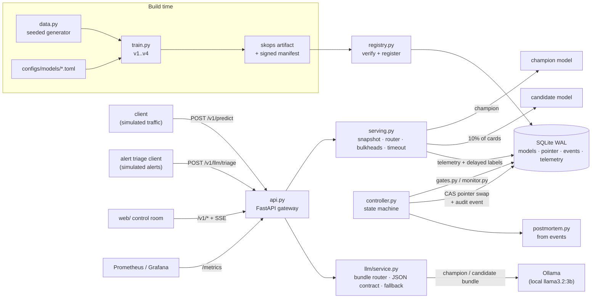

# Spectral Canary Works

Spectral Canary Works is a small, complete model-release system that runs on one laptop. Four real
fraud-scoring models (scikit-learn, trained on a seeded synthetic dataset) move through registration, an
offline gate, shadow scoring, a 10% sticky canary and promotion, behind a FastAPI gateway that serves real
predictions. One candidate passes every offline check and then fails under a **simulated** shift in traffic.
The controller detects this from paired, labeled evidence, rolls traffic back to the previous model with one
atomic pointer swap, confirms with real predictions that recovery worked, and writes a postmortem from its own
hash-chained audit log. A second lane puts an LLM component (a fraud-alert triage prompt on a local
`llama3.2:3b` via Ollama) through the same registry, controller, audit chain and rollback path. It is for
engineers and reviewers who want to see, and rerun, the engineering between "the model scores well" and "the
model is safe to serve", with every number traceable to a recorded run.

## At a glance

| | |
|---|---|
| **Status** | Working, local-first. ML lane: release pipeline, guardrails, rollback, chaos suite, load test, Docker stack and UI. LLM lane: prompt-bundle registry, eval gate, canary with SLOs, rollback, promptfoo gate. Nothing is deployed to any cloud. |
| **Stack** | Python 3.12 (uv), FastAPI, scikit-learn, skops, SQLite (WAL); Ollama (local), promptfoo, OpenTelemetry; React + Vite + TypeScript UI; Docker, Prometheus, Grafana; OpenTofu; GitHub Actions |
| **Run it** | `make setup && make demo` (full ML release story over real HTTP), or `make start` (UI + API on http://127.0.0.1:5120) |
| **Data and traffic** | Synthetic data from documented seeded generators. Request and alert traffic is a seeded **simulation**, labeled `simulated` on every request, event and screen. LLM-lane labels come from a rule table, not from people. |
| **AI Engineer reviewers** | Start at [LLM release lane results](#llm-release-lane-for-ai-engineer-reviewers) |
| **Verified** | 2026-11-09 against `main` at `b27bc04` plus this PR's CI and docs changes ([how](#testing-and-ci)) |

## Why this exists

### The problem

A model that scores well offline can still fail after deployment. The offline test split is frozen at
training time, so it under-represents whatever becomes common later. Fraud labels arrive weeks late, and some
never arrive. Traffic shifts. So "is this model safe to ship?" can't be answered by one number on a held-out
set, and "is it still working?" can't be answered by a dashboard of feature histograms.

This project builds and measures a full answer to three operational questions:

1. **How do you decide a model is safe to ship?**
2. **How do you know it is degrading once it's live?**
3. **Exactly how do you recover, and how do you prove you did?**

### Why the obvious approaches fall short

| obvious approach | why it isn't enough |
|---|---|
| "The new model's test PR-AUC is higher, ship it" | Here v2 beats v1 by 0.020 PR-AUC, inside overlapping 95% intervals. That is noise, not proof. And an aggregate number hides a defect confined to a segment the test split barely contains. |
| "Watch feature drift in production" | In a canary both models see the same traffic. Drift says the world moved; it says nothing about whether the *candidate* is worse than the *champion*. |
| "Watch production accuracy" | Labels are delayed and partial, and a 10% canary at ~6% fraud collects few labeled positives. A naive accuracy comparison on that sample makes confident claims from noise. |
| "Roll back by redeploying the old version" | Slow, racy with concurrent promotions, unverified, and it loses the evidence of what happened. |

### Principles that follow (and where they show up in the code)

- **Ship on non-inferiority, not on "better by one number".** The offline gate checks margins against the
  champion, per-slice recall, calibration, reproducibility, latency and artifact integrity
  ([`gates.py`](src/spectral_canary/gates.py), [`configs/release_policy.toml`](configs/release_policy.toml)).
- **Compare the two models on the same requests.** On every canary request the champion is also scored and
  recorded, so labeled quality is a *paired* comparison judged with an exact McNemar test (ADR-5).
- **Make no quality claim without enough labels.** Below 20 labeled frauds per arm, a window records
  `insufficient` and promotion stays blocked ([`monitor.py`](src/spectral_canary/monitor.py)).
- **Count the independent unit.** Requests from one card are correlated; guardrail statistics use one
  observation per card. This rule was learned the hard way (see [How it was built](#how-it-was-built)).
- **In the ML lane, drift raises an alert, never a rollback.** Rollback needs evidence that the candidate is
  worse than the champion on comparable traffic. (The LLM lane treats major input drift differently, on purpose;
  see [How it works](#the-llm-lane-same-controller-different-evidence).)
- **Rollback is a pointer swap, not a redeploy.** One compare-and-swap of the deployment pointer, in the same
  SQLite transaction as its audit event, followed by verification through real predictions
  ([`store.py`](src/spectral_canary/store.py), [`controller.py`](src/spectral_canary/controller.py)).
- **Only verified bytes serve, and failure is closed.** Artifacts are hash-checked and type-allowlisted before
  loading. If the champion can't serve, the gateway answers 503, never a made-up score.
- **Every decision leaves evidence.** Events are append-only and hash-chained, each release records the policy
  file's SHA-256, and the postmortem is generated from the events, not written by hand.

### Why the same machinery for an LLM

A prompt edit, a model swap or a serving-parameter change is a release too, and it fails in the same ways. The
LLM lane (merged in [PR #3](https://github.com/AlexRosen23/spectral-canary-works/pull/3)) tests whether the
controller's ideas hold when the "model" is a prompt bundle (prompt + model tag + pinned weights digest +
sampling parameters, hashed and signed as one unit). Its recorded runs show two things:
- **An aggregate score hides an asymmetric regression.** A prompt with one escalation rule removed kept its
  overall pass^3 inside the margin. Escalation recall on must-escalate alerts, overall and per segment, is what
  blocked it.
- **A configuration-only change can fail in production for a real reason.** Raising `num_ctx` from 2048 to 4096
  gave identical answers offline. In the canary, the shared Ollama server reloaded the model on every switch
  between the two context sizes, and the latency SLO rolled the change back.

### What it answers

The engineering question is: *can a release process catch a regression that passes every offline check,
recover from it automatically, and prove both?* The recorded run answers yes for the defect built to test it.
v3 was trained on a label snapshot taken before chargebacks matured on high-value card-not-present
transactions. That segment holds about 3% of test frauds, so offline v3 sits inside every margin. Under the
simulated surge the segment holds about a quarter of the frauds, and the canary rolled v3 back on paired
evidence: 65 vs 83 of 112 labeled frauds, p = 0.0015. The project also records where the answer stops being
yes. When the gateway itself is saturated, timeouts are not evidence against the model, so the guardrail
pauses instead of rolling back (see [Limitations](#limitations-and-whats-next)).

The defect is constructed, and the data is synthetic. Synthetic data with a known label mechanism is what lets
the simulation deliver delayed labels at all, which a static public benchmark can't do. The cost is external
validity, stated in [`docs/DRIFT_AND_LIMITATIONS.md`](docs/DRIFT_AND_LIMITATIONS.md).

## What works today

"Simulated" means the request traffic is seeded and generated; the predictions, routing, statistics and
rollbacks it drives are real executions of this code.

| capability | status | how it was verified |
|---|---|---|
| Seeded dataset (40,000 rows) + 4 trained models with signed, hash-verified skops artifacts | Working | `make train-fixtures` reproduces the committed dataset and test-prediction hashes in `manifests/` (rerun 2026-11-09; also inside the Linux Docker build in CI) |
| Held-out evaluation with 95% CIs, validation-only thresholds | Working | `make eval`; numbers in `manifests/models/*.json` |
| Offline gate (integrity, schema, reproducibility, golden ordering, latency, calibration, non-inferiority, slices) | Working | `tests/test_release_controller.py`; v4 blocked on 7 checks in the recorded demo |
| Shadow scoring that can't change responses | Working | `test_shadow_never_changes_responses` |
| 10% sticky canary routing with version headers | Working | `tests/test_store_and_routing.py`; `X-Model-Version` checked in CI's container smoke test |
| Guardrails: error budget, latency vs champion, flag rate (Newcombe CI), paired McNemar recall, all per card | Working | `test_guardrail_counts_cards_not_requests`, `test_guardrail_ignores_small_samples`, recorded demo |
| Atomic, idempotent, verified rollback + generated postmortem | Working | `tests/test_e2e.py` (in-process and over real HTTP); [`docs/INCIDENT_POSTMORTEM.md`](docs/INCIDENT_POSTMORTEM.md) |
| Promotion with separation of duties (creator can't approve) | Working | recorded demo (self-approval refused with 403); API tests |
| Restart recovery, stuck-release revert, approve-vs-rollback race | Working | `make chaos-replay`: `restart_recovery`, `promotion_race` |
| Seeded chaos suite: 11 failure scenarios with expected outcomes | Working | `make chaos-replay`: 10/10 (rerun 2026-11-09); the 11th, `gateway_saturation`, added later the same day, passed with `latency_spike` and `candidate_timeout` |
| Feature drift (PSI) and score drift (Jensen–Shannon) | Working (alert only, by design) | chaos `distribution_shift`; `/v1/drift` |
| HTTP load test with SLOs | Working (one loaded laptop) | `make loadtest`; [`docs/LOAD_TEST_RESULTS.md`](docs/LOAD_TEST_RESULTS.md) (2026-11-09, commit `f015610`) |
| Control-room UI (release track, traffic, quality, incident replay, drift, compare, postmortem, registry, reproducibility) | Working, local | renders only recorded API data; 7 web unit tests (incl. a paused canary and a saturation pause); `npm run build` |
| Prometheus metrics, SSE event stream, redacted JSON logs, trace IDs | Working | `/metrics` checked in CI's container smoke test |
| Docker image (non-root, read-only root filesystem) + compose stack with Prometheus and Grafana | Working, local Docker | CI `image` job builds, smoke-tests and Trivy-scans it; `make up` / `make down` verified during the build (2026-11-09) |
| OpenTofu `infra/local` (Docker provider) | Working, local | applied and destroyed against local Docker during the build; `fmt` + `validate` in CI |
| OpenTofu `infra/aws` (ECR + one `t4g.micro`, SSM, IMDSv2, Budgets) | Partial: validated, **not provisioned** | `fmt` + `validate` only; `scripts/aws_deploy.sh` refuses to run without `SCW_CONFIRM_BILLABLE=yes`. $0 spent. Two documented, accepted Trivy findings (public IP, HTTPS egress) |
| GitHub Actions CI (5 PR jobs + a relative LLM gate on LLM-lane PRs) | Working | enabled 2026-11-09; first real runs are on this README's PR ([Testing and CI](#testing-and-ci)) |
| Read-only contract for dashboards (`/health`, `/capabilities`, `/runs`) | Working | `make start` checked on 2026-11-09 (`/health` ok, `/runs` lists the runs); the owner's Constellation reads it |
| **LLM lane:** prompt bundles as immutable, hashed, signed releasable units with the Ollama weights digest pinned | Working | `tests/test_llm_lane.py` (tampered prompt and changed weights digest both blocked) |
| **LLM lane:** offline eval gate (150 gold cases × 3 seeded tries, code graders, pass^3, per-segment escalation recall, non-inferiority) | Working (rule-derived labels) | recorded run [`llm-demo-20261109-130256`](docs/evidence/llm/llm-demo-20261109-130256/RESULTS.md): p3 and the qwen swap blocked; gold set checked by `make llm-gold` (rerun 2026-11-09) |
| **LLM lane:** shadow + 10% canary with online code grading, paired McNemar, p95 latency and token-cost SLOs, input-drift trigger | Working (simulated alerts, real local model calls) | same recorded run: p2 promoted after 2 healthy windows; ctx4k rolled back on the latency SLO |
| **LLM lane:** automatic rollback (same controller), 20 verification calls, generated postmortem | Working | [`postmortem-llm-rel-0004.md`](docs/evidence/llm/llm-demo-20261109-130256/postmortem-llm-rel-0004.md); `test_llm_release_story_in_process` (scripted test double) |
| **LLM lane:** promptfoo regression gate (`make llm-gate`, threshold 90%) | Working | saved output in [`docs/evidence/llm/promptfoo/`](docs/evidence/llm/promptfoo/) (champion 92.7%, regressed prompt 74.0%, exit 100); rerun locally 2026-11-09: 139/150 (92.7%), identical. On a GitHub CPU runner the same champion scores 84.7%, so CI gates on base vs head on one runner instead (`make llm-gate-relative`, see [Testing and CI](#testing-and-ci)) |
| **LLM lane:** OpenTelemetry GenAI metrics on `/metrics`, Grafana panels, control-room panel | Working | `test_llm_api_and_genai_metrics`; the recorded run's [`metrics-genai.prom`](docs/evidence/llm/llm-demo-20261109-130256/metrics-genai.prom) |
| LLM-as-judge or human-calibrated graders, hosted model, human labels | Not built | the lane uses code graders and rule-derived labels by design ([`docs/LLM_RELEASE_LANE.md`](docs/LLM_RELEASE_LANE.md)) |
| Saturation-aware guardrail (pause instead of rolling back when the gateway itself is overloaded) | Working (fault-injected; load test not rerun) | chaos `gateway_saturation`; `test_timeouts_under_saturation_are_inconclusive_not_a_breach` and 3 related tests; closes finding 5 in [`docs/LOAD_TEST_RESULTS.md`](docs/LOAD_TEST_RESULTS.md) |
| Multi-replica controller, Postgres registry, sequential testing (mSPRT), real identity provider | Not built | described as upgrades in [`docs/ARCHITECTURE_DECISIONS.md`](docs/ARCHITECTURE_DECISIONS.md) |

## Quick start

**Requirements:** macOS or Linux, [uv](https://docs.astral.sh/uv/) (Python 3.12 is installed by uv), Node 22
and npm, `make`. Docker is optional (only for `make up`, `make docker-build`, `make iac-validate` and
`make workflow-lint`). [Ollama](https://ollama.com) with `llama3.2:3b` is needed only for the LLM lane's live
commands (`make llm-gate`, `make llm-eval`, `make llm-demo`; `make llm-demo` also needs `qwen2.5-coder:3b`). The
LLM lane's tests use a scripted test double, so `make test` doesn't need Ollama. No cloud account, API key or
GPU.

```bash
make setup            # uv sync + npm ci; creates local operator tokens and a signing key in var/secrets (gitignored)
make train-fixtures   # seeded dataset + v1..v4; fails if any hash differs from manifests/
make eval             # held-out metrics table for every version
make demo             # the whole release story over real HTTP on :5120, printing expected vs actual
make start            # gateway + built control room on http://127.0.0.1:5120 (what the Constellation launches)
```

**Expected result of `make demo`:** `rel-0001` v1→v2 promoted, `rel-0002` v4 blocked by the offline gate,
`rel-0003` v2→v3 rolled back automatically in canary window 4, 50/50 verification predictions served by v2,
and the audit chain and registry verified. On the build machine (a loaded Apple Silicon laptop) the demo takes
about 2.5 minutes. Each run writes a directory under `var/runs/` with a registry, an event log, a
`report.json` and a postmortem.

| command | what it does |
|---|---|
| `make test` | all Python tests, including end-to-end failure→rollback in-process **and** over real HTTP |
| `make chaos-replay` | 11 seeded failure scenarios with expected outcomes |
| `make verify` | re-hash every artifact, check manifest signatures and the audit hash chain |
| `make loadtest` | real HTTP load test on a dedicated gateway (:5130); raw per-request results saved |
| `make serve` / `make web` | gateway on :5120 / Vite dev UI on :5121 (for UI work) |
| `make ci` | lint + mypy + fixtures + contract + tests + chaos + web build, as CI runs them |
| `make up` / `make down` | Docker stack: gateway :5120, UI :5121, simulated traffic, Prometheus :5122, Grafana :5123 / full teardown |
| `make iac-validate` | OpenTofu `fmt` + `validate` for `infra/local` and `infra/aws` (no plan, no apply) |
| `make workflow-lint` | actionlint on `.github/workflows` (Docker) |
| `make llm-gold` | check the committed triage gold set against its seeded generator (seconds) |
| `make llm-gate` | promptfoo regression suite (pinned 0.125.1) against local Ollama; fails under the 90% pass-rate threshold (calibrated on Apple Metal) |
| `make llm-gate-relative` | the same suite for a base ref (`LLM_GATE_BASE`, default `origin/main`) and this checkout on one machine; fails when this one is more than 2.2 points below the base. CI's PR gate |
| `make llm-eval B=<bundle>` | offline suite for one prompt bundle (150 cases × 3 tries, real local model calls) |
| `make llm-demo` | the LLM lane story over real HTTP on :5141 with real local model calls (about 2 h on the build laptop when every suite runs live) |

`make start` also trains, builds the UI and records an in-process demo run first, if any of those are
missing. Both `make demo` and `make start` need a free port: if 5120 is taken, `make demo` refuses to start
and the server in `make start` fails to bind. Use `API_PORT=<port>` (for example `make demo API_PORT=5151`)
to run next to an existing gateway.

## How it works



### One release, end to end (`rel-0003`, the failure path)

1. **Register.** `train.py` fits v3 from [`configs/models/v3-hgb-fresh.toml`](configs/models/v3-hgb-fresh.toml),
   picks the threshold on the validation split and writes a skops artifact and a `model_artifact_v1` manifest
   (hashes, schema, metrics). [`registry.py`](src/spectral_canary/registry.py) re-hashes the bytes, checks
   every serialized type against the allowlist in [`artifacts.py`](src/spectral_canary/artifacts.py), loads it
   and signs the manifest.
2. **Offline gate.** `POST /v1/releases` runs [`gates.py`](src/spectral_canary/gates.py) against the frozen
   test split. v3 is within every margin (PR-AUC 0.600 vs v2's 0.620, margin 0.03) and passes.
3. **Stage and shadow.** The artifact is loaded and smoke-tested. In shadow mode the champion answers every
   request and v3 scores it afterwards, recorded only. The shadow gate needs at least 400 requests, an error
   rate of 1% or less, score JS divergence of 0.20 or less, and decision disagreement of 15% or less. Over 600
   shadow requests v3 measured JS 0.011 and 0.5% disagreement.
4. **Canary.** The pointer moves to `mode=canary, fraction=0.10`.
   [`serving.py`](src/spectral_canary/serving.py) routes by `sha256(salt:request_key) mod 10000`, so the same
   card always lands in the same arm. Each request runs on one immutable snapshot of the pointer, in its own
   thread pool per arm, with a 500 ms timeout. On candidate requests the champion is also scored, and the
   result is recorded for the paired test.
5. **Guardrails.** Every 1,500 routed requests (a logical clock, so replays are deterministic),
   [`monitor.py`](src/spectral_canary/monitor.py) evaluates the window. Windows 1 and 2 (baseline traffic)
   were healthy. Then the simulated surge starts. Window 3 is still healthy but raises a `drift.alert`
   (max PSI 2.2), and drift alone doesn't act. In window 4, on 112 labeled frauds served by v3, v3 caught 65,
   and v2, scored on the same requests, would have caught 83. Exact one-sided McNemar p = 0.0015 < 0.01: a
   breach.
6. **Rollback.** [`Controller.rollback`](src/spectral_canary/controller.py) swaps the pointer back
   (`candidate=None, mode=none`) with compare-and-swap on the deployment generation, in the same transaction
   as the release state change and the `rollback.executed` event. In-flight requests finish on the snapshot
   they started with.
7. **Verify and explain.** 50 real predictions must all be served by v2 and readiness must pass
   (`rollback.verified`). 200 more shifted requests are all served by v2.
   [`postmortem.py`](src/spectral_canary/postmortem.py) then writes the postmortem from the event log.

### The LLM lane: same controller, different evidence

[`llm/controller.py`](src/spectral_canary/llm/controller.py) subclasses the ML `Controller` and only supplies
LLM evidence through its hooks: offline gate, staging smoke, shadow summary, window evaluation, verification
payloads and postmortem. How a release moves, swaps its pointer, records events and rolls back is the same code.
The LLM-specific parts are:
- [`llm/bundles.py`](src/spectral_canary/llm/bundles.py): the bundle as one canonical, hashed, signed JSON;
- [`llm/gates.py`](src/spectral_canary/llm/gates.py) with [`llm/graders.py`](src/spectral_canary/llm/graders.py)
  and [`llm/evals.py`](src/spectral_canary/llm/evals.py): code graders, pass^3 and per-segment escalation recall
  against the champion on the same cases and seeds;
- [`llm/monitor.py`](src/spectral_canary/llm/monitor.py): online grading, paired McNemar on must-escalate alerts,
  latency and token-cost SLOs against the same-window champion arm, and an input-drift trigger;
- [`llm/otel.py`](src/spectral_canary/llm/otel.py): OpenTelemetry GenAI metrics.

One deliberate difference: in the LLM lane, a major input drift *is* a rollback trigger, because the offline evidence
that justified the canary no longer describes the traffic. The full design is in
[`docs/LLM_RELEASE_LANE.md`](docs/LLM_RELEASE_LANE.md).

The rules and every threshold are in [`docs/RELEASE_POLICY.md`](docs/RELEASE_POLICY.md); the mechanics and
the failure-mode table are in [`docs/RELEASE_AND_ROLLBACK.md`](docs/RELEASE_AND_ROLLBACK.md); the module map
is in [`docs/ARCHITECTURE.md`](docs/ARCHITECTURE.md).

## How it was built

Built by Claude Code sessions on 2026-11-08 and 2026-11-09 from a written spec with five phases, then a
"production proof" addendum (Docker, IaC, load tests, ADRs, CI, an interop contract), then an LLM release
lane. Rule from the spec: a working vertical slice first (real trained models and one real inference by the end
of phase A), with no invented metrics.

### Phases and milestones

| phase | what landed | where |
|---|---|---|
| A. Substrate | seeded dataset, v1/v2 training, typed predict API, artifact registration, manifests, first real inference | [PR #1](https://github.com/AlexRosen23/spectral-canary-works/pull/1) (`be68cfa`) |
| B. Release controller | offline gate, state machine, shadow, sticky canary, CAS rollback, hash-chained event log, deterministic fixtures | PR #1 |
| C. Reliability | guardrails, PSI/JS drift, seeded chaos suite, fault injection, generated postmortems, restart/stuck recovery | PR #1 |
| D. Control room | React UI driven only by recorded API data and SSE: release track, incident replay, compare, registry, reproducibility drawer | PR #1 |
| E. Packaging + production proof | Dockerfile, compose stack with Prometheus/Grafana, OpenTofu local + AWS, load test + SLOs, ADRs, runbooks, `model_artifact_v1` contract, evidence file, CI workflow | PR #1 (`dc464b9`, `f015610`, `a760635`), merged 2026-11-09 |
| Integration | read-only `/health` `/capabilities` `/runs` contract; UI and API on one port; `scripts/start.sh` | [PR #2](https://github.com/AlexRosen23/spectral-canary-works/pull/2), merged 2026-11-09 |
| Constellation | world "The Canary Control Room" in the owner's Constellation dashboard, which starts the app on demand | AlexRosen23/constellation#359 and #360 (private repo) |
| LLM release lane | controller hooks; prompt bundles, gold set, code graders, eval gate, online SLOs, OTel GenAI metrics, promptfoo gate, control-room panel, recorded runs, ADR-9 (why not MLflow) | [PR #3](https://github.com/AlexRosen23/spectral-canary-works/pull/3), merged 2026-11-09 |
| License + visibility | the MIT `LICENSE` file; the repository made public on the owner's OK | [PR #5](https://github.com/AlexRosen23/spectral-canary-works/pull/5), 2026-11-09 |
| CI + write-up | Actions enabled; CI fixed and green on its first real runs; this README | [PR #4](https://github.com/AlexRosen23/spectral-canary-works/pull/4) |

### Key decisions and trade-offs

The full records are in [`docs/ARCHITECTURE_DECISIONS.md`](docs/ARCHITECTURE_DECISIONS.md).

- **Synthetic data over a public benchmark.** Known labels make delayed-label simulation possible. The cost is
  external validity.
- **SQLite (WAL) for the registry, events and telemetry.** Triggers make model rows immutable and events
  append-only, and the pointer and its audit event commit together. The cost is a single writer; the upgrade
  path is Postgres.
- **A paired design for labeled guardrails** (ADR-5). It needs far fewer labels than comparing independent
  arms, at the cost of about one extra model call on 10% of traffic, which the load test measures.
- **A logical clock for guardrail windows** (ADR-4). Replays are deterministic, and on a loaded laptop wall
  time varies 10× or more. The cost: one request per window pays the evaluation latency.
- **skops with a type allowlist, not pickle** (ADR-6). New model families need their types reviewed.
- **No Kubernetes** (ADR-2). One CPU-bound gateway doesn't justify a control plane, and an empty manifest
  would only be decoration.
- **The LLM lane reuses this registry and controller instead of MLflow** (ADR-9). The point of the lab is the
  release controller (CAS pointer swaps, separation of duties, paired online guardrails), which MLflow's
  mutable prompt aliases don't provide. An MLflow export is described but not implemented.
- **AWS path on one EC2 instance, not provisioned** (ADR-7). It is estimated at about US$10–11/month and
  stays off until the owner approves spending.

### Problems hit and how they were solved

| problem | cause | fix |
|---|---|---|
| Single-row inference ~95 ms p50 instead of ~5 ms | OpenMP thread pools spin-waiting on an oversubscribed machine | cap native threads at 1 (`OMP_NUM_THREADS=1` + `threadpoolctl`, [`serving.limit_native_threads`](src/spectral_canary/serving.py)) |
| The postmortem's impact (124 labeled frauds, 28 missed) looked like it contradicted its own detection evidence (65 vs 83 of 112) | impact counted requests (repeat cards) and one direction of disagreement, with labels that kept arriving after the rollback | count cards like the guardrail, both directions and the net, with labels as of the rollback (`Store.requests_since(labels_as_of=…)`); a test checks the impact equals the breach's paired evidence and does not change when later labels arrive |
| Incident replay showed the final verdict ("window 4: breach") while the cursor sat before the canary had started | the evidence panel fell back to the last breach when the cursor wasn't on an evaluation | show the latest evaluation at or before the cursor, or say there is none yet |
| skops refused to load the gradient-boosting models | two types outside the allowlist | reviewed and allowlisted `functools.partial` and `sklearn.utils.validation.check_array` (ADR-6) |
| Healthy models blocked or rolled back on latency | absolute budgets on a shared, heavily loaded laptop | latency must exceed the budget **and** 6× the champion measured alongside, best of 3 rounds (`dc464b9`) |
| A slow candidate could delay champion answers | one shared thread pool | separate bulkhead executors per arm |
| Container crash-looped after a rebuild | a persisted registry referenced the previous image's artifact hashes | fail closed (readiness 503, gateway stays up) and key the container's registry to the artifact digest (`dc464b9`) |
| **The c=32 load test rolled back a healthy model** | 146 candidate requests came from only 38 cards, and the flag-rate CI treated them as independent | all guardrail statistics count one observation per card; regression test (`f015610`) |
| The guardrail blames the model when the gateway is saturated | at c ≥ 16, queueing pushes candidate calls past the 500 ms timeout | when the champion's own model-call p95 is over `saturation_champion_p95_ms` (100 ms) in the same window and every failure over the error budget is a timeout, the window is `inconclusive_saturated` and the release **pauses**: the candidate leaves traffic, no postmortem blames it, and an operator resumes or rolls back. Real errors and quality breaches still roll back |
| The UI requested a postmortem for a load-test run (404) | it took the newest run, not the newest demo | read the latest demo run (PR #2) |
| LLM lane: a symmetric pass rate would have shipped both bad candidates | the regressed prompt and the model swap had equal or higher overall escalate accuracy than the champion (61.3% and 69.3% vs 62.0%), because under-escalating wins on the should-not-escalate cases | gate on recall for must-escalate alerts, overall and per segment; the promptfoo suite was rewritten the same way (PR #3) |
| LLM lane: the first recorded run "failed" | a hypothesis about the 12-case smoke subset was written as an expected outcome | the smoke result became a recorded observation, not an expectation (`6d89c4d`); the rerun (offline suites reused, same bundle hashes) passed with the same four decisions |
| LLM lane: a "no-op" `num_ctx` change failed in canary | one Ollama server holding two context sizes of the same model reloads it on every switch | a real finding, not a bug: the same-window latency SLO caught it and rolled back |
| CI had never actually run | the workflow wasn't valid YAML (an unquoted `:` in a step name), so GitHub couldn't read its triggers and refused `workflow_dispatch` | quoted in PR #3; PR #4 adds `make workflow-lint` (actionlint) so it can't recur |
| First CI run: pip-audit failed | `uv export` listed the project itself, which isn't on PyPI | `--no-emit-project` (PR #4) |
| First CI run: Trivy failed the image | 2 CRITICAL CVEs in Debian 12 with no fixed package (libsqlite3 CVE-2025-7458, zlib CVE-2023-45853) | base image moved to `python:3.12-slim-trixie` (Debian 13) (PR #4) |
| LLM gate on GitHub: the champion prompt failed its own threshold | the 90% threshold was calibrated on Apple Metal; on the runner's CPU backend the same weights, Ollama, prompt and seed scored 84.7% | evidence saved; CI now runs a relative gate (base vs PR head on the same runner, fails on a drop over 2.2 points) |
| Second CI run: Trivy's filesystem scan failed on misconfigurations | the web image relied on its base image's non-root user without saying so; the AWS path has a public-IP subnet and HTTPS egress to any address | `USER 101:101` in `web/Dockerfile`; the two AWS findings are documented accepted risks with a costed alternative (~$43/month), suppressed per rule inline ([`docs/SECURITY_AND_SECRETS.md`](docs/SECURITY_AND_SECRETS.md)) (PR #4) |

Designing the degraded candidate also took iteration. It had to pass the offline gate *honestly* and fail
under shift for a stated, mechanistic reason. The first generator's signal was too weak to separate
the models. The final v3 is a label-maturity bug. In training, the 93 card-not-present rows above $1,200
included 77 frauds, and all 77 were relabeled 0. v4 is the contrast case: a data filter dropped 819
high-value card-not-present rows, and the offline gate catches it.

## Results and evidence

### Held-out metrics (synthetic test split: 8,000 rows, 487 frauds)

Source: the committed manifests [`manifests/models/*.json`](manifests/models), reproduced on 2026-11-09 by
`make train-fixtures && make eval`. Intervals are 95% bootstrap intervals. Thresholds were chosen on
validation (max F1).

| version | what it is | PR-AUC [95% CI] | precision | recall | F1 | ECE |
|---|---|---|---|---|---|---|
| `v1-logreg` | logistic regression (champion at bootstrap) | 0.600 [0.552–0.642] | 0.606 | 0.534 | 0.568 | 0.004 |
| `v2-hgb` | isotonic-calibrated gradient boosting | 0.620 [0.570–0.662] | 0.654 | 0.550 | 0.598 | 0.005 |
| `v3-hgb-fresh` | **degraded**: immature label snapshot (77 positives relabeled 0) | 0.600 [0.558–0.643] | 0.609 | 0.544 | 0.575 | 0.003 |
| `v4-hgb-segfilter` | **degraded**: filter dropped 819 high-value card-not-present rows | 0.493 [0.451–0.532] | 0.519 | 0.431 | 0.471 | 0.017 |

v2 ships because it is non-inferior with better point estimates, not because it is significantly better.

### Rollback evidence

Source: run `demo-20261109-001407` (real HTTP, gateway commit `f015610`, 2026-11-09). The generated
postmortem is in [`docs/INCIDENT_POSTMORTEM.md`](docs/INCIDENT_POSTMORTEM.md), regenerated from that run's own event
log after an audit found its impact section counted requests in one direction (124 labeled frauds, 28 missed), which
read as if it contradicted the 65 vs 83 of 112 cards that triggered the rollback. It now counts cards as the guardrail
does, both directions, with labels known at the rollback: 112 cards, 26 missed only by the candidate and 8 only by the
champion, net 18. Each claim is in [`resume_evidence/metrics.json`](resume_evidence/metrics.json) with its command and
commit. Rerun for this README on 2026-11-09 (run `demo-20261109-140904`, real HTTP, 114.6 s): identical outcome and
numbers. Same 65 vs 83 of 112, same p = 0.0015, 50/50 verified, 34-event chain intact. A clean-state rerun
(fresh state directory, `make demo` on another port) at 17:46 CST matched again.

| release | outcome | evidence |
|---|---|---|
| `rel-0001` v1→v2 | promoted after 4 healthy windows and a release-manager approval (self-approval refused, 403) | 50/50 verification predictions served by v2 |
| `rel-0002` v4 | blocked by the offline gate | 7 failed checks, e.g. PR-AUC 0.127 below the champion and recall on `merchant=electronics` 0.336 below |
| `rel-0003` v2→v3 | rolled back automatically in canary window 4 | candidate caught 65/112 labeled frauds vs the champion's 83/112 on the same requests (exact McNemar p = 0.0015); 50/50 verification; 200 post-rollback requests all served by v2; audit chain of 34 events verified |

### Chaos suite

`make chaos-replay`, rerun 2026-11-09: 10/10 scenarios matched their expected outcomes. The scenarios are
schema break, distribution shift (drift alert, no traffic moved), degraded predictions, latency spike,
candidate timeout (champion answers with `X-Fallback`), partial outage (fail closed 503), corrupted artifact
(never becomes champion), repeat rollback (idempotent), restart recovery, and an approve-vs-rollback race.
The 11th, gateway saturation (champion slowed to 60 ms and every candidate call past the timeout), pauses
instead of rolling back, keeps every response at HTTP 200 and then resumes; its counterpart `candidate_timeout`
(same timeouts, fast champion) still rolls back.

### Load test

Source: [`docs/LOAD_TEST_RESULTS.md`](docs/LOAD_TEST_RESULTS.md), run `loadtest-20261109-001009`, commit
`f015610`. Machine: Apple M5 Pro, 18 cores, 48 GB, **1-minute load average 12.7–27.5 from other work**. One
uvicorn process; closed-loop clients; simulated payloads.

| SLO (concurrency ≤ 16, this machine) | objective | result |
|---|---|---|
| availability | ≥ 99.5% | met in 6/6 cells (100%) |
| client p95 latency | ≤ 250 ms | met in 6/6 cells (worst 174.5 ms) |
| telemetry completeness | 0 dropped rows | met in 6/6 cells |

Peak throughput was 390.9 rps (champion only, c=4). The canary costs about 2× per candidate request, because
of the paired champion call. These are relative numbers from a loaded laptop, not capacity planning figures.

### LLM release lane (for AI Engineer reviewers)

The 60-second path. A fraud-alert triage prompt (local `llama3.2:3b` via Ollama, structured JSON output) goes
through the *same* registry, controller, audit chain and rollback path as the ML models. The releasable unit is a
hashed, signed **prompt bundle**: prompt + model + pinned weights digest + parameters.

1. **Read the recorded run:** [`docs/evidence/llm/llm-demo-20261109-130256/RESULTS.md`](docs/evidence/llm/llm-demo-20261109-130256/RESULTS.md).
   It is generated from the run files: real Ollama calls over real HTTP, simulated alerts. Reproduce it with
   `make llm-demo`, or run `make test` for the same story against a scripted test double in seconds.
2. **Look at:** [`llm/controller.py`](src/spectral_canary/llm/controller.py) (LLM evidence plugged into the ML
   controller's hooks), [`llm/gates.py`](src/spectral_canary/llm/gates.py) (code graders, pass^3, per-segment
   escalation recall), [`llm/monitor.py`](src/spectral_canary/llm/monitor.py) (online grading, p95 latency and
   token-cost SLOs, input-drift trigger), [`evals/triage/promptfooconfig.yaml`](evals/triage/promptfooconfig.yaml)
   (the CI regression gate) and [`llm/otel.py`](src/spectral_canary/llm/otel.py) (OpenTelemetry GenAI metrics).
3. **Headline numbers** (150 gold cases × 3 seeded tries, code graders only; rule-derived labels, not human):

| release | outcome | evidence (offline: 150 cases × 3 tries; online: 10% canary, 200-request windows) |
|---|---|---|
| `triage-p1` → `triage-p2` (same policy, greedy decoding) | **promoted** | escalation recall 75.2% → 83.3%, pass^3 31.3% → 36.7%; shadow + 2 healthy canary windows; release-manager approval (self-approval refused, 403) |
| `triage-p3` (one escalation rule dropped) | **blocked offline** | escalation recall 40.9% vs 83.3%, all three segment checks failed. Its pass^3 (34.0%) was inside the margin: an aggregate score alone would have shipped it |
| `triage-p2-qwen` (model swap to qwen2.5-coder:3b) | **blocked offline** | 4.6% cheaper and 13% lower offline p95, but escalation recall 42.4% vs 83.3% |
| `triage-p2-ctx4k` (`num_ctx` 2048 → 4096 only) | **rolled back automatically** | identical answers offline; in canary the shared Ollama server reloaded the model on every switch: candidate p95 2,830 ms vs 1,342 ms for the champion arm (2.11×, SLO 1.5×); 20/20 verification calls answered by p2; postmortem generated |

Source: run `llm-demo-20261109-130256` (commit `6d89c4d`, 1,408 s, passed). The first, fully live run
(`llm-demo-20261109-111237`, 110 min) reached the same four decisions. The promptfoo gate (`make llm-gate`,
threshold 90%) passes the champion prompt at 92.7% and fails the regressed prompt at 74.0% (exit 100):
[`docs/evidence/llm/promptfoo/`](docs/evidence/llm/promptfoo/). Rerun on 2026-11-09 on the build machine:
139/150 (92.7%), identical.

**A portability finding.** Run on a GitHub-hosted runner with the same model weights (identical manifest and layer
digests), the same Ollama version (0.40.13), prompt, parameters and seed, the champion scored **127/150 (84.7%)**.
All 23 failures were missed escalations: recall 65.2% vs 83.3%. The runner uses Ollama's CPU backend and the Mac
uses Metal, and greedy decoding isn't bit-identical across compute backends. A threshold calibrated on one
backend therefore doesn't transfer to another. Evidence: [`triage-p2.github-cpu.*`](docs/evidence/llm/promptfoo/)
(run [42692611563](https://github.com/AlexRosen23/spectral-canary-works/actions/runs/42692611563)). So the CI gate is
relative: it scores the PR base and the PR head on the same runner and fails when the head drops more than 2.2
pass-rate points (the policy's 0.05 escalation-recall margin over 66 of 150 must-escalate cases) below the base.

Caveats: a 3B local model gets only 37% of whole replies right on this policy (reported, not hidden). Labels are
rule-derived, graders are code, alert traffic is simulated, and latency comes from a shared laptop.

More: [`docs/LLM_RELEASE_LANE.md`](docs/LLM_RELEASE_LANE.md) (the full write-up) ·
[`docs/AI_ENGINEER_READINESS.md`](docs/AI_ENGINEER_READINESS.md) (what this does and doesn't evidence for AI
Engineer roles) · [`docs/media/walkthrough.webm`](docs/media/walkthrough.webm) (walkthrough video).


| automatic rollback of the config-only change, with its generated postmortem | the ML lane in the same control room |
|---|---|
|  |  |

## Limitations and what's next

- **Synthetic data, constructed defect.** The metrics describe this generator, not real fraud. Real fraud
  has adversaries and feedback loops that are not modeled here.
- **Saturation handling is a threshold, not a capacity model.** Timeouts are attributed to the gateway when the
  champion's own p95 crosses a fixed 100 ms line in the same window. It is verified by fault injection, not by
  rerunning the c=16/32 load test, and a candidate that is both broken and unlucky enough to be judged only
  during an overload is paused rather than rolled back (still out of traffic). **Next:** rerun the load test,
  and derive the line from the champion's measured baseline instead of a constant.
- **Repeated testing without alpha-spending.** Guardrails re-test every window at p < 0.01. **Next:** a
  sequential test such as mSPRT.
- **Single process.** Guardrail window counters live in the API process. Replicas would need them in the shared
  store and one elected controller (ADR-4).
- **Local controls, not enterprise IAM.** Roles are random bearer tokens with only their hashes stored.
- **The offline latency check measures on the machine it runs on.** It takes the best of 3 interleaved rounds against
  the champion, but with no champion (bootstrap) only the absolute 50 ms budget applies. During this project's
  2026-11-09 audit the Mac was at a load average near 200 from unrelated jobs, and the check failed closed twice:
  once refusing v2 inside `make chaos-replay` (`degraded_predictions` errored, 9/10), once refusing the bootstrap
  champion in a test fixture. Both passed on rerun, and it has not happened on a CI runner. **Next:** pin the
  latency gate to a quiet, dedicated runner, or compare against a recorded baseline for the bootstrap case.
- **Not deployed.** The AWS path is validated but not provisioned, and $0 has been spent. Provisioning needs
  the owner's approval and an expected cost.
- **LLM lane: labels and graders.** Labels come from a rule table and graders are code. There is no LLM-as-judge
  and no human calibration, so the gold set measures whether a prompt follows a written policy, not fraud
  judgement. 150 cases × 3 tries can't resolve differences of a few points, which is why the margins are wide.
  **Next:** human-labeled cases and a calibrated judge for the rationale.
- **LLM lane: the promptfoo scores are backend-specific.** The absolute 90% threshold of `make llm-gate` holds on
  the machine where it was calibrated, not on a CPU CI runner (84.7% vs 92.7% for the same champion). CI therefore
  gates on the difference between the PR base and head on one runner. That catches a regression the PR introduces,
  not a model that is weak on every backend, and a 2.2-point margin on 150 cases can't see smaller drops.
- **LLM lane: small canary windows.** About 20 candidate calls per 200 routed requests, so per-window p95 is
  noisy. The same-window ratio absorbs whole-machine slowdowns, not variance.

The full list is in [`docs/DRIFT_AND_LIMITATIONS.md`](docs/DRIFT_AND_LIMITATIONS.md).

## Repository map

| path | what lives there |
|---|---|
| `src/spectral_canary/` | the package: data, training, artifacts, registry, store, serving, gates, monitor, controller, postmortem, API, telemetry, traffic/chaos/load drivers, CLI (`scw`) |
| `src/spectral_canary/llm/` | the LLM triage lane: alerts and gold set, bundles, graders, evals, gates, service, monitor, controller hooks, OTel GenAI metrics, postmortem |
| `web/` | React + TypeScript control room (hand-written SVG charts, SSE feed, incident replay, reproducibility drawer, LLM lane panel) |
| `configs/` | immutable model configs (`models/*.toml`) and `release_policy.toml` (every threshold); `llm/` holds prompts, bundles and the LLM lane's policy |
| `evals/triage/` | the triage gold set (generator-checked) and the promptfoo regression suite |
| `manifests/` | committed dataset and model manifests (hashes, metrics). The artifacts themselves are regenerated, not committed. |
| `contracts/` | `model_artifact_v1` JSON Schema + example, a framework-neutral artifact contract |
| `tests/` | unit, API, store/routing, release controller, and end-to-end failure→rollback tests |
| `scripts/` | `start.sh`, contract check, evidence builder, relative LLM gate (`llm_gate_relative.sh`, `llm_gate_compare.py`), IaC validation, AWS deploy/teardown (guarded) |
| `deploy/` | Prometheus scrape config, Grafana datasource and dashboard |
| `infra/local`, `infra/aws` | OpenTofu: local Docker (applied + destroyed in testing) / AWS (validated, not provisioned) |
| `docs/` | policy, rollback, drift, data card, architecture, ADRs, threat model, runbooks, load test, costs, postmortem, case study, LLM lane |
| `docs/evidence/llm/`, `docs/media/` | the LLM lane's recorded runs, gate reports, promptfoo output; control-room screenshots and walkthrough video |
| `resume_evidence/` | `metrics.json`: every claim with its command, artifact, commit and status |
| `var/` (gitignored) | generated data, artifacts, registries, event logs, run reports, local secrets |

## Testing and CI

```bash
make test        # all Python tests (pytest), incl. e2e failure->rollback in-process and over real HTTP
make test-fast   # unit tests only (skips the e2e marker)
make llm-gold    # gold set matches its generator
make llm-gate    # promptfoo gate against local Ollama (needs llama3.2:3b), absolute 90% threshold (Metal-calibrated)
make llm-gate-relative LLM_GATE_BASE=origin/main   # base vs this checkout on one machine: the CI pull-request gate
cd web && npm test
make ci          # everything CI's python + web jobs run
```

Latest local run (2026-11-09, this branch rebased on `b27bc04`, Apple M5 Pro under a load average of 13–17):
**66 Python tests** (50 ML lane + 16 LLM lane) in 10 min: 65 passed. The one failure,
`test_rollback_over_real_http`, couldn't bind its port because an orphaned server from an interrupted earlier run held
it. With that process stopped, it passed on rerun (138 s). Also: **5 web tests passed**, chaos replay
10/10, ruff and mypy clean, contract check and `make llm-gold` passed. The suite is slow because of three
end-to-end tests, not the unit tests: replay determinism (186 s), the chaos suite (172 s) and the in-process
release story (76 s) each drive thousands of simulated requests. Since then (PR #7) the HTTP test binds a free port, so an orphaned
server can't fail it again. The in-process story and its determinism replay are one test whose two runs execute in
parallel processes. The HTTP test now drives `scw demo` itself. Each chaos scenario is its own test.

**GitHub Actions is enabled** (the owner turned it on on 2026-11-09). `.github/workflows/ci.yml` runs 5 jobs on
pull requests and manual dispatch. A separate workflow, `llm-gate.yml`, runs the relative LLM gate only on pull
requests that touch the LLM lane:

| job | what it checks |
|---|---|
| `python` | ruff, mypy, fixture training with hash checks, contract check, `scw chaos-replay` on one scenario (CLI smoke), then pytest on 4 workers: unit and API tests, the release story with its determinism replay (two runs in parallel processes), `scw demo` over real HTTP, and every chaos scenario as its own test |
| `security` | pip-audit on the locked dependencies, gitleaks over the full history, npm audit, Trivy filesystem scan |
| `web` | TypeScript typecheck, unit tests, production build |
| `image` | Docker build (which retrains and re-verifies hashes on Linux), container smoke test, Trivy image scan |
| `iac` | OpenTofu `fmt` + `validate` (no plan, no apply, no credentials) |
| `llm-gate` | **relative** promptfoo gate, in its own workflow (`llm-gate.yml`), on PRs that touch `configs/llm/`, `evals/triage/`, the LLM code, `scripts/llm_gate_*` or that workflow (a native `pull_request.paths` filter, so the Ollama service container, pinned by digest, starts only then), and on manual dispatch (`gh workflow run llm-gate --ref <branch>`). It checks out the PR base next to the head, runs the 150-case suite for both on the same runner, and fails if the head's pass rate is more than 2.2 points below the base's (the policy's 0.05 escalation-recall margin × 66/150 must-escalate cases). The log shows both pass rates. Recorded on PR #6: base = head on each runner (127/150 on one CPU, 136/150 on another), PASS; the regressed `triage-p3` as head on a third runner: 127 → 104/150, FAIL. 26–41 min. An absolute threshold can't work here: the 90% one was calibrated on Apple Metal, and on the runner's CPU backend the accepted champion scores 84.7% (see [the portability finding](#llm-release-lane-for-ai-engineer-reviewers)). |

The workflow file had never been valid YAML, so before 2026-11-09 it had never run (see
[How it was built](#how-it-was-built)). Its first real runs, on
[PR #4](https://github.com/AlexRosen23/spectral-canary-works/pull/4), passed `python`, `web` and `iac` from the
start. They caught real problems in `security` (pip-audit's input, then Trivy misconfigurations) and in `image`
(Debian 12 CVEs), all fixed in that PR (see the problems table above). PR #4's checks show the current result.

**Duration.** The repository is public, and standard GitHub-hosted runners are free for public repositories, so CI
costs time, not money (it does not draw on the account's private-repo minutes). CI runs on pull requests and manual
dispatch only.

- Before ([run 42692611563](https://github.com/AlexRosen23/spectral-canary-works/actions/runs/42692611563), PR #4):
  the `python` job took 21 min and ran everything serially on one of the runner's 4 cores. It also ran the chaos
  suite and the release story twice, once in pytest and once through the CLI. The five PR jobs used about 24
  runner-minutes, and on PR #6 an LLM-lane change added a 28–37 min `llm-gate` run. That gate also fired on any
  `Makefile` or `ci.yml` edit.
- After (PR #7): see the measured numbers on PR #7. The duplicate stories are gone, the rest runs on 4 pytest-xdist
  workers, and `llm-gate` runs only when the LLM lane changes.
- Why it is CPU-bound: a cProfile of one in-process release story (16,400 requests) spends about 90% of its time
  in scikit-learn single-row inference. The calibrated v2/v3 models are 3-fold ensembles, so each prediction runs the
  preprocessing pipeline three times, and joblib's per-call dispatch is about 38% of that.

No job needs a secret.

## Related

- Policy and mechanics: [release policy](docs/RELEASE_POLICY.md) · [release and rollback](docs/RELEASE_AND_ROLLBACK.md) · [drift and limitations](docs/DRIFT_AND_LIMITATIONS.md) · [data card](docs/DATA_CARD.md)
- Architecture: [code level](docs/ARCHITECTURE.md) · [system](docs/SYSTEM_ARCHITECTURE.md) · [ADRs](docs/ARCHITECTURE_DECISIONS.md) · [threat model](docs/THREAT_MODEL.md) · [security and secrets](docs/SECURITY_AND_SECRETS.md)
- Operations: [operations runbook](docs/OPERATIONS_RUNBOOK.md) · [deployment runbook](docs/DEPLOYMENT_RUNBOOK.md) · [load test results](docs/LOAD_TEST_RESULTS.md) · [cloud costs](docs/CLOUD_COSTS.md) · [incident postmortem](docs/INCIDENT_POSTMORTEM.md)
- LLM lane: [design and results](docs/LLM_RELEASE_LANE.md) · [AI Engineer readiness](docs/AI_ENGINEER_READINESS.md) · [recorded evidence](docs/evidence/llm/)
- Write-ups: [public case study](docs/PUBLIC_CASE_STUDY.md) · [interview defense](docs/INTERVIEW_DEFENSE.md) · [recruiter demo](docs/RECRUITER_DEMO.md) · [contributing](CONTRIBUTING.md)
- Constellation: world `proj:spectral-canary-works`, "The Canary Control Room", in the owner's private Constellation dashboard. It reads `/health`, `/capabilities` and `/runs` and starts the app with `./scripts/start.sh`.
- License: [MIT](LICENSE) for the code. The dataset is generated by this code and contains no real people, cards or payments.
