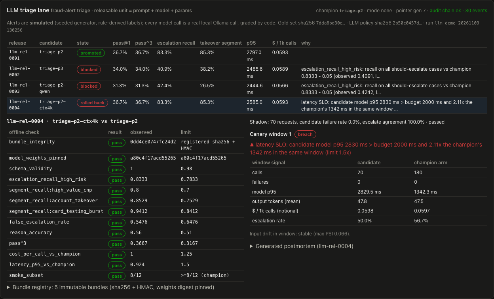
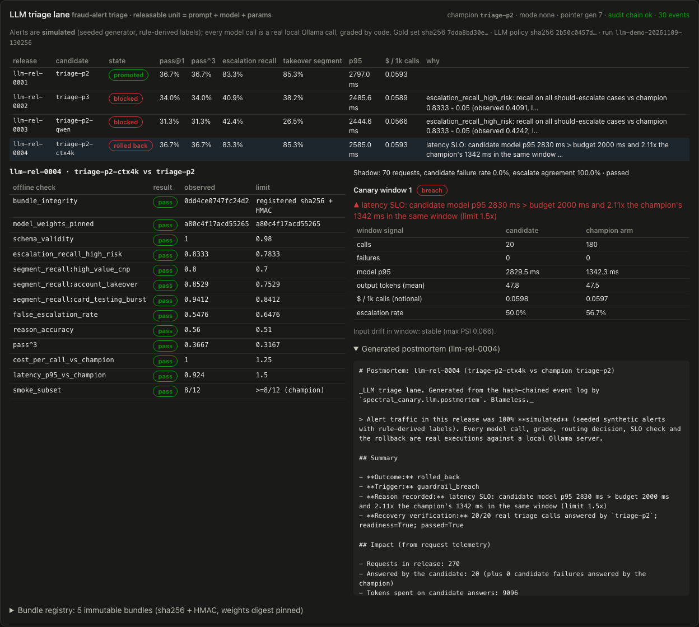
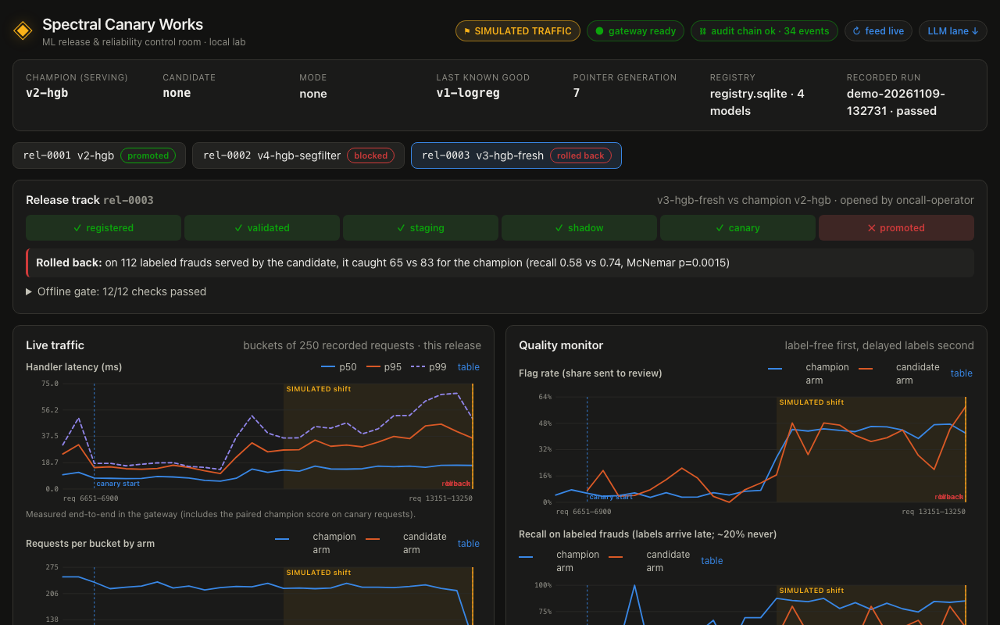

# Spectral Canary Works

**A local-first ML release and reliability lab.** Real trained models move through registration → offline
gate → shadow → 10% canary → promotion. A deliberately degraded candidate passes every offline check, then
fails under a **simulated** distribution shift and is **automatically rolled back** by the controller, with
the evidence, the audit trail and a generated postmortem to show for it.

It answers three questions from code and recorded artifacts:

1. **How do you decide a model is safe to deploy?** → [`docs/RELEASE_POLICY.md`](docs/RELEASE_POLICY.md), `src/spectral_canary/gates.py`
2. **How do you know it is degrading?** → [`docs/DRIFT_AND_LIMITATIONS.md`](docs/DRIFT_AND_LIMITATIONS.md), `src/spectral_canary/monitor.py`
3. **Exactly how do you recover?** → [`docs/RELEASE_AND_ROLLBACK.md`](docs/RELEASE_AND_ROLLBACK.md), `Controller.rollback`

> **Honesty labels.** The data is synthetic (seeded, documented generator). Request traffic is a seeded
> **simulation**, marked `simulated` on every request, event and UI view. Predictions, routing, statistics,
> rollbacks, chaos outcomes and load-test numbers are real executions measured on one shared Apple Silicon
> laptop. **Nothing is deployed to any cloud.** The AWS path is implemented and validated, not provisioned.

## For AI Engineer reviewers (60 seconds)

This branch adds an **LLM release lane**: a fraud-alert triage prompt (local `llama3.2:3b` via Ollama, structured JSON
output) goes through the *same* registry, controller, audit chain and rollback path as the ML models. The releasable
unit is a hashed, signed **prompt bundle** (prompt + model + pinned weights digest + params).

1. **Read the recorded run:** [`docs/evidence/llm/llm-demo-20261109-130256/RESULTS.md`](docs/evidence/llm/llm-demo-20261109-130256/RESULTS.md) (generated from the
   run files; real Ollama calls over real HTTP, simulated alerts). Reproduce with `make llm-demo` (needs Ollama with
   `llama3.2:3b` and `qwen2.5-coder:3b`), or `make test` for the same story against a scripted test double in seconds.
2. **Look at:** [`llm/controller.py`](src/spectral_canary/llm/controller.py) (LLM evidence plugged into the ML
   controller's hooks), [`llm/gates.py`](src/spectral_canary/llm/gates.py) (code graders, pass^3, per-segment
   escalation recall), [`llm/monitor.py`](src/spectral_canary/llm/monitor.py) (online grading, p95 latency and
   token-cost SLOs, input-drift trigger), [`evals/triage/promptfooconfig.yaml`](evals/triage/promptfooconfig.yaml)
   (CI regression gate), [`llm/otel.py`](src/spectral_canary/llm/otel.py) (OpenTelemetry GenAI metrics).
3. **Headline numbers** (150 gold cases x 3 seeded tries, code graders only; rule-derived labels, not human):

| release | outcome | evidence (offline: 150 cases x 3 tries; online: 10% canary, 200-request windows) |
|---|---|---|
| `triage-p1` -> `triage-p2` (same policy, greedy decoding) | **promoted** | escalation recall 75.2% -> 83.3%, pass^3 31.3% -> 36.7%; shadow + 2 healthy canary windows; release-manager approval (self-approval refused, 403) |
| `triage-p3` (one escalation rule dropped) | **blocked offline** | escalation recall 40.9% vs 83.3%, all three segment checks failed. Its pass^3 (34.0%) was inside the margin: an aggregate score alone would have shipped it |
| `triage-p2-qwen` (model swap to qwen2.5-coder:3b) | **blocked offline** | 4.6% cheaper and 13% lower offline p95, but escalation recall 42.4% vs 83.3% |
| `triage-p2-ctx4k` (`num_ctx` 2048 -> 4096 only) | **rolled back automatically** | identical answers offline; in canary the shared Ollama server reloaded the model on every switch: candidate p95 2,830 ms vs 1,342 ms for the champion arm (2.11x, SLO 1.5x); 20/20 verification calls answered by p2; postmortem generated |

The promptfoo CI gate (`make llm-gate`, threshold 90%) passes the champion prompt at 92.7% and fails the regressed
prompt at 74.0% (exit 100): [`docs/evidence/llm/promptfoo/`](docs/evidence/llm/promptfoo/).

Caveats: a 3B local model gets only 37% of whole replies right on this policy (reported, not hidden); labels are
rule-derived, graders are code, alert traffic is simulated, latency is from a shared laptop. The first, fully live
run (`llm-demo-20261109-111237`, 110 min) reached the same four decisions.

Full write-up: [`docs/LLM_RELEASE_LANE.md`](docs/LLM_RELEASE_LANE.md) · what this does and does not evidence for AI
Engineer roles: [`docs/AI_ENGINEER_READINESS.md`](docs/AI_ENGINEER_READINESS.md) · walkthrough video
[`docs/media/walkthrough.webm`](docs/media/walkthrough.webm).



| automatic rollback of the config-only change, with its generated postmortem | the ML lane in the same control room |
|---|---|
|  |  |

## Quickstart (native macOS, CPU)

```bash
make setup            # uv + npm deps, local secrets (gitignored)
make train-fixtures   # seeded dataset + 4 model versions (verifies hashes vs manifests/)
make demo             # the full release story over real HTTP; prints expected vs actual
make serve            # gateway  http://127.0.0.1:5120   (serves the latest recorded run)
make web              # control room  http://127.0.0.1:5121
```

| command | what it does |
|---|---|
| `make start` | **one port for everything:** builds what is missing, then the gateway, its read-only contract and the built control room on http://127.0.0.1:5120 (what the Constellation's launcher runs) |
| `make test` | 49 Python tests (plus 5 web unit tests via `npm test`): unit, API contract, end-to-end failure→rollback (in-process **and** over real HTTP), replay determinism, chaos suite |
| `make eval` | held-out metrics table for every version |
| `make chaos-replay` | 10 seeded failure scenarios with expected outcomes |
| `make loadtest` | real HTTP load test at fixed concurrency levels; raw per-request results saved |
| `make verify` | re-hash every artifact, check manifest signatures and the audit hash chain |
| `make ci` | lint + mypy + fixtures + contract + all tests + chaos + web build (the CI workflow, run locally) |
| `make up` / `make down` | production-like Docker stack (gateway, UI, simulated traffic, Prometheus, Grafana) / full teardown |
| `make iac-validate` | OpenTofu fmt + validate for `infra/local` and `infra/aws` (no plan, no apply) |
| `make llm-demo` | LLM lane story over real HTTP on :5141 with real local Ollama calls (about 2 h on a busy laptop) |
| `make llm-gate` | promptfoo regression suite (pinned 0.125.1) against local Ollama; fails under the pass-rate threshold |
| `make llm-eval B=<bundle>` / `make llm-gold` | offline suite for one bundle (k=3) / check the committed gold set against its generator |

Ports: API 5120, web 5121 (Docker stack: Prometheus 5122, Grafana 5123). The load test uses 5130.

## Models (held-out test split: 8,000 rows, 487 frauds, synthetic)

| version | what | PR-AUC [95% CI] | precision | recall | F1 | ECE |
|---|---|---|---|---|---|---|
| `v1-logreg` | logistic regression baseline (champion at bootstrap) | 0.600 [0.552–0.642] | 0.606 | 0.534 | 0.568 | 0.004 |
| `v2-hgb` | isotonic-calibrated gradient boosting | 0.620 [0.570–0.662] | 0.654 | 0.550 | 0.598 | 0.005 |
| `v3-hgb-fresh` | **degraded**: trained on an immature 30-day label snapshot (77 positives relabeled 0) | 0.600 [0.558–0.643] | 0.609 | 0.544 | 0.575 | 0.003 |
| `v4-hgb-segfilter` | **degraded**: data filter dropped 819 high-value card-not-present rows | 0.493 [0.451–0.532] | 0.519 | 0.431 | 0.471 | 0.017 |

Thresholds are chosen on the validation split (max F1); the test split is never used for selection. v2's
improvement over v1 is within the confidence intervals: it ships because it is **non-inferior** with better
point estimates, not because it is significantly better.

## The recorded story (`make demo`, run `demo-20261109-001407`, commit `f015610`, 146 s, real HTTP)

| release | outcome | evidence |
|---|---|---|
| `rel-0001` v1→v2 | **promoted** after 4 healthy canary windows + release-manager approval (self-approval refused, 403) | 50/50 verification predictions served by v2 |
| `rel-0002` v4 | **blocked** by the offline gate | 7 failed checks, e.g. PR-AUC 0.127 below champion; recall on `merchant=electronics` 0.336 below |
| `rel-0003` v2→v3 | **rolled back automatically** in canary window 4 | on 112 labeled frauds (one per card) the candidate served it caught 65; the champion, scored on the same requests, would have caught 83 (exact McNemar p = 0.0015). Rollback verified 50/50; 200 post-rollback requests all served by v2; postmortem generated |

Audit chain verified (34 events); registry hashes and signatures verified. v3 passed offline because its defect
is confined to a segment holding about 3% of test positives; under the simulated surge that segment held
about a quarter of the positives. That's exactly the gap canaries exist to cover.

## What's in the box

```
src/spectral_canary/   gateway (FastAPI), registry, controller, guardrails, chaos, load test, CLI
src/spectral_canary/llm/  LLM triage lane: bundles, graders, evals, gates, service, monitor, OTel GenAI metrics
evals/triage/          gold set (generator-checked) + promptfoo regression suite
web/                   React + TypeScript control room (SVG charts, SSE event feed, replay, repro drawer)
configs/               model configs (immutable versions) + release_policy.toml (every threshold)
manifests/             committed dataset + model manifests (hashes, metrics), not the artifacts
contracts/             model_artifact_v1 JSON Schema + example (framework-neutral interop contract)
infra/local, infra/aws OpenTofu: local Docker (applied + destroyed in testing) / AWS (validated, NOT provisioned)
deploy/                Prometheus scrape config, Grafana datasource + dashboard
docs/                  policy, drift, threat model, architecture, runbooks, ADRs, costs, load test, case study
resume_evidence/       metrics.json: every claim with command, artifact, commit, status
```

## Read-only contract (for dashboards)

`GET /health`, `/capabilities`, `/runs`, `/runs/{run_id}` (project id `spectral-canary`). Runs are the recorded demo,
chaos and load-test reports in `var/runs/`, each labeled `mode: simulated` with this project's own headline. The owner's
Constellation reads these for its "Canary Control Room" world and starts the app with `./scripts/start.sh`.

## CI status

`.github/workflows/ci.yml` defines lint, types, tests (incl. the e2e rollback over real HTTP), chaos replay,
pip-audit/npm audit/gitleaks/Trivy, image build + container smoke test, web build and IaC validation.
**GitHub Actions is disabled on this private repo** (owner decision; Actions minutes are shared). Every job
runs locally with `make ci`, `make docker-build` and `make iac-validate`.

## Documentation

[Release policy](docs/RELEASE_POLICY.md) · [Release & rollback](docs/RELEASE_AND_ROLLBACK.md) ·
[Drift & limitations](docs/DRIFT_AND_LIMITATIONS.md) · [Data card](docs/DATA_CARD.md) ·
[Architecture](docs/ARCHITECTURE.md) · [System architecture](docs/SYSTEM_ARCHITECTURE.md) ·
[ADRs](docs/ARCHITECTURE_DECISIONS.md) · [Threat model](docs/THREAT_MODEL.md) ·
[Security & secrets](docs/SECURITY_AND_SECRETS.md) · [Operations runbook](docs/OPERATIONS_RUNBOOK.md) ·
[Deployment runbook](docs/DEPLOYMENT_RUNBOOK.md) · [Load test results](docs/LOAD_TEST_RESULTS.md) ·
[Cloud costs](docs/CLOUD_COSTS.md) · [Incident postmortem](docs/INCIDENT_POSTMORTEM.md) ·
[Recruiter demo](docs/RECRUITER_DEMO.md) · [Interview defense](docs/INTERVIEW_DEFENSE.md) ·
[Public case study](docs/PUBLIC_CASE_STUDY.md) · [LLM release lane](docs/LLM_RELEASE_LANE.md) ·
[AI Engineer readiness](docs/AI_ENGINEER_READINESS.md) · [Contributing](CONTRIBUTING.md)

## License

MIT for the code. The dataset is generated by this code; it contains no real people, cards or payments.
