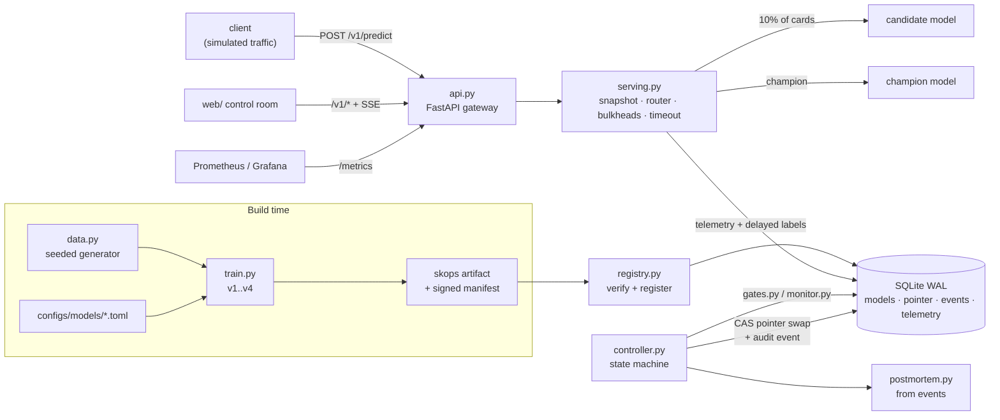

# Spectral Canary Works

Spectral Canary Works is a small, complete model-release system that runs on one laptop. Four real
fraud-scoring models (scikit-learn, trained on a seeded synthetic dataset) move through registration, an
offline gate, shadow scoring, a 10% sticky canary and promotion, behind a FastAPI gateway that serves real
predictions. One candidate passes every offline check and then fails under a **simulated** shift in traffic.
The controller detects this from paired, labeled evidence, rolls traffic back to the previous model with one
atomic pointer swap, confirms with real predictions that recovery worked, and writes a postmortem from its own
hash-chained audit log. It is for engineers and reviewers who want to see, and rerun, the engineering between
"the model scores well" and "the model is safe to serve", with every number traceable to a recorded run.

## At a glance

| | |
|---|---|
| **Status** | Working, local-first. Release pipeline, guardrails, rollback, chaos suite, load test, Docker stack and UI all run. Nothing is deployed to any cloud. |
| **Stack** | Python 3.12 (uv), FastAPI, scikit-learn, skops, SQLite (WAL); React + Vite + TypeScript UI; Docker, Prometheus, Grafana; OpenTofu |
| **Run it** | `make setup && make demo` (full release story over real HTTP), or `make start` (UI + API on http://127.0.0.1:5120) |
| **Data and traffic** | Synthetic data from a documented seeded generator. Request traffic is a seeded **simulation**, labeled `simulated` on every request, event and screen. |
| **Verified** | 2026-11-09 against `main` at `d69f2e4` plus this PR's CI and docs changes ([how](#testing-and-ci)) |

## Why this exists

### The problem

A model that scores well offline can still fail after deployment. The offline test split is frozen at
training time, so it under-represents whatever becomes common later. Fraud labels arrive weeks late, and some
never arrive. Traffic shifts. So "is this model safe to ship?" can't be answered by one number on a held-out
set, and "is it still working?" can't be answered by a dashboard of feature histograms.

This project builds and measures a full answer to three operational questions:

1. **How do you decide a model is safe to ship?**
2. **How do you know it is degrading once it's live?**
3. **Exactly how do you recover, and how do you prove you did?**

### Why the obvious approaches fall short

| obvious approach | why it isn't enough |
|---|---|
| "The new model's test PR-AUC is higher, ship it" | Here v2 beats v1 by 0.020 PR-AUC, inside overlapping 95% intervals. That is noise, not proof. And an aggregate number hides a defect confined to a segment the test split barely contains. |
| "Watch feature drift in production" | In a canary both models see the same traffic. Drift says the world moved; it says nothing about whether the *candidate* is worse than the *champion*. |
| "Watch production accuracy" | Labels are delayed and partial, and a 10% canary at ~6% fraud collects few labeled positives. A naive accuracy comparison on that sample makes confident claims from noise. |
| "Roll back by redeploying the old version" | Slow, racy with concurrent promotions, unverified, and it loses the evidence of what happened. |

### Principles that follow (and where they show up in the code)

- **Ship on non-inferiority, not on "better by one number".** The offline gate checks margins against the
  champion, per-slice recall, calibration, reproducibility, latency and artifact integrity
  ([`gates.py`](src/spectral_canary/gates.py), [`configs/release_policy.toml`](configs/release_policy.toml)).
- **Compare the two models on the same requests.** On every canary request the champion is also scored and
  recorded, so labeled quality is a *paired* comparison judged with an exact McNemar test (ADR-5).
- **Make no quality claim without enough labels.** Below 20 labeled frauds per arm, a window records
  `insufficient` and promotion stays blocked ([`monitor.py`](src/spectral_canary/monitor.py)).
- **Count the independent unit.** Requests from one card are correlated; guardrail statistics use one
  observation per card. This rule was learned the hard way (see [How it was built](#how-it-was-built)).
- **Drift raises an alert, never a rollback.** Rollback needs evidence that the candidate is worse than the
  champion on comparable traffic.
- **Rollback is a pointer swap, not a redeploy.** One compare-and-swap of the deployment pointer, in the same
  SQLite transaction as its audit event, followed by verification through real predictions
  ([`store.py`](src/spectral_canary/store.py), [`controller.py`](src/spectral_canary/controller.py)).
- **Only verified bytes serve, and failure is closed.** Artifacts are hash-checked and type-allowlisted before
  loading. If the champion can't serve, the gateway answers 503, never a made-up score.
- **Every decision leaves evidence.** Events are append-only and hash-chained, each release records the policy
  file's SHA-256, and the postmortem is generated from the events, not written by hand.

### What it answers

The engineering question is: *can a release process catch a regression that passes every offline check,
recover from it automatically, and prove both?* The recorded run answers yes for the defect built to test it.
v3 was trained on a label snapshot taken before chargebacks matured on high-value card-not-present
transactions. That segment holds about 3% of test frauds, so offline v3 sits inside every margin. Under the
simulated surge the segment holds about a quarter of the frauds, and the canary rolled v3 back on paired
evidence: 65 vs 83 of 112 labeled frauds, p = 0.0015. The project also records where the answer stops being
yes. The guardrail can't yet tell a broken model from a saturated gateway (see
[Limitations](#limitations-and-whats-next)).

The defect is constructed, and the data is synthetic. Synthetic data with a known label mechanism is what lets
the simulation deliver delayed labels at all, which a static public benchmark can't do. The cost is external
validity, stated in [`docs/DRIFT_AND_LIMITATIONS.md`](docs/DRIFT_AND_LIMITATIONS.md).

## What works today

"Simulated" means the request traffic is seeded and generated; the predictions, routing, statistics and
rollbacks it drives are real executions of this code.

| capability | status | how it was verified |
|---|---|---|
| Seeded dataset (40,000 rows) + 4 trained models with signed, hash-verified skops artifacts | Working | `make train-fixtures` reproduces the committed dataset and test-prediction hashes in `manifests/` (rerun 2026-11-09; also inside the Linux Docker build in CI) |
| Held-out evaluation with 95% CIs, validation-only thresholds | Working | `make eval`; numbers in `manifests/models/*.json` |
| Offline gate (integrity, schema, reproducibility, golden ordering, latency, calibration, non-inferiority, slices) | Working | `tests/test_release_controller.py`; v4 blocked on 7 checks in the recorded demo |
| Shadow scoring that can't change responses | Working | `test_shadow_never_changes_responses` |
| 10% sticky canary routing with version headers | Working | `tests/test_store_and_routing.py`; `X-Model-Version` checked in CI's container smoke test |
| Guardrails: error budget, latency vs champion, flag rate (Newcombe CI), paired McNemar recall, all per card | Working | `test_guardrail_counts_cards_not_requests`, `test_guardrail_ignores_small_samples`, recorded demo |
| Atomic, idempotent, verified rollback + generated postmortem | Working | `tests/test_e2e.py` (in-process and over real HTTP); [`docs/INCIDENT_POSTMORTEM.md`](docs/INCIDENT_POSTMORTEM.md) |
| Promotion with separation of duties (creator can't approve) | Working | recorded demo (self-approval refused with 403); API tests |
| Restart recovery, stuck-release revert, approve-vs-rollback race | Working | `make chaos-replay`: `restart_recovery`, `promotion_race` |
| Seeded chaos suite: 10 failure scenarios with expected outcomes | Working | `make chaos-replay`: 10/10 (rerun 2026-11-09) |
| Feature drift (PSI) and score drift (Jensen–Shannon) | Working (alert only, by design) | chaos `distribution_shift`; `/v1/drift` |
| HTTP load test with SLOs | Working (one loaded laptop) | `make loadtest`; [`docs/LOAD_TEST_RESULTS.md`](docs/LOAD_TEST_RESULTS.md) (2026-11-09, commit `f015610`) |
| Control-room UI (release track, traffic, quality, incident replay, drift, compare, postmortem, registry, reproducibility) | Working, local | renders only recorded API data; 5 web unit tests; `npm run build` |
| Prometheus metrics, SSE event stream, redacted JSON logs, trace IDs | Working | `/metrics` checked in CI's container smoke test |
| Docker image (non-root, read-only root filesystem) + compose stack with Prometheus and Grafana | Working, local Docker | CI `image` job builds, smoke-tests and Trivy-scans it; `make up` / `make down` verified during the build (2026-11-09) |
| OpenTofu `infra/local` (Docker provider) | Working, local | applied and destroyed against local Docker during the build; `fmt` + `validate` in CI |
| OpenTofu `infra/aws` (ECR + one `t4g.micro`, SSM, IMDSv2, Budgets) | Partial: validated, **not provisioned** | `fmt` + `validate` only; `scripts/aws_deploy.sh` refuses to run without `SCW_CONFIRM_BILLABLE=yes`. $0 spent. |
| GitHub Actions CI (5 jobs) | Working | enabled 2026-11-09; first real run is on this README's PR ([Testing and CI](#testing-and-ci)) |
| Read-only contract for dashboards (`/health`, `/capabilities`, `/runs`) | Working | `scripts/check_contract.py`; the owner's Constellation reads it |
| Saturation-aware guardrail (pause instead of rolling back when the gateway itself is overloaded) | Not built | open finding 5 in [`docs/LOAD_TEST_RESULTS.md`](docs/LOAD_TEST_RESULTS.md) |
| Multi-replica controller, Postgres registry, sequential testing (mSPRT), real identity provider | Not built | described as upgrades in [`docs/ARCHITECTURE_DECISIONS.md`](docs/ARCHITECTURE_DECISIONS.md) |

## Quick start

**Requirements:** macOS or Linux, [uv](https://docs.astral.sh/uv/) (Python 3.12 is installed by uv), Node 22
and npm, `make`. Docker is optional (only for `make up`, `make docker-build` and `make iac-validate`). No cloud
account, API key or GPU.

```bash
make setup            # uv sync + npm ci; creates local operator tokens and a signing key in var/secrets (gitignored)
make train-fixtures   # seeded dataset + v1..v4; fails if any hash differs from manifests/
make eval             # held-out metrics table for every version
make demo             # the whole release story over real HTTP on :5120, printing expected vs actual
make start            # gateway + built control room on http://127.0.0.1:5120 (what the Constellation launches)
```

**Expected result of `make demo`:** `rel-0001` v1→v2 promoted, `rel-0002` v4 blocked by the offline gate,
`rel-0003` v2→v3 rolled back automatically in canary window 4, 50/50 verification predictions served by v2,
and the audit chain and registry verified. On the build machine (a loaded Apple Silicon laptop) the demo takes
about 2.5 minutes. Each run writes a directory under `var/runs/` with a registry, an event log, a
`report.json` and a postmortem.

| command | what it does |
|---|---|
| `make test` | all Python tests, including end-to-end failure→rollback in-process **and** over real HTTP |
| `make chaos-replay` | 10 seeded failure scenarios with expected outcomes |
| `make verify` | re-hash every artifact, check manifest signatures and the audit hash chain |
| `make loadtest` | real HTTP load test on a dedicated gateway (:5130); raw per-request results saved |
| `make serve` / `make web` | gateway on :5120 / Vite dev UI on :5121 (for UI work) |
| `make ci` | lint + mypy + fixtures + contract + tests + chaos + web build, as CI runs them |
| `make up` / `make down` | Docker stack: gateway :5120, UI :5121, simulated traffic, Prometheus :5122, Grafana :5123 / full teardown |
| `make iac-validate` | OpenTofu `fmt` + `validate` for `infra/local` and `infra/aws` (no plan, no apply) |
| `make workflow-lint` | actionlint on `.github/workflows` (Docker) |

`make start` also trains, builds the UI and records an in-process demo run first, if any of those are
missing. Both `make demo` and `make start` need a free port: if 5120 is taken, `make demo` refuses to start
and the server in `make start` fails to bind. Use `API_PORT=<port>` (for example `make demo API_PORT=5151`)
to run next to an existing gateway.

## How it works



### One release, end to end (`rel-0003`, the failure path)

1. **Register.** `train.py` fits v3 from [`configs/models/v3-hgb-fresh.toml`](configs/models/v3-hgb-fresh.toml),
   picks the threshold on the validation split and writes a skops artifact and a `model_artifact_v1` manifest
   (hashes, schema, metrics). [`registry.py`](src/spectral_canary/registry.py) re-hashes the bytes, checks
   every serialized type against the allowlist in [`artifacts.py`](src/spectral_canary/artifacts.py), loads it
   and signs the manifest.
2. **Offline gate.** `POST /v1/releases` runs [`gates.py`](src/spectral_canary/gates.py) against the frozen
   test split. v3 is within every margin (PR-AUC 0.600 vs v2's 0.620, margin 0.03) and passes.
3. **Stage and shadow.** The artifact is loaded and smoke-tested. In shadow mode the champion answers every
   request and v3 scores it afterwards, recorded only. The shadow gate needs at least 400 requests, an error
   rate of 1% or less, score JS divergence of 0.20 or less, and decision disagreement of 15% or less. v3
   measured 0.011 and 0.5%.
4. **Canary.** The pointer moves to `mode=canary, fraction=0.10`.
   [`serving.py`](src/spectral_canary/serving.py) routes by `sha256(salt:request_key) mod 10000`, so the same
   card always lands in the same arm. Each request runs on one immutable snapshot of the pointer, in its own
   thread pool per arm, with a 500 ms timeout. On candidate requests the champion is also scored, and the
   result is recorded for the paired test.
5. **Guardrails.** Every 1,500 routed requests (a logical clock, so replays are deterministic),
   [`monitor.py`](src/spectral_canary/monitor.py) evaluates the window. Windows 1–3 were healthy. The simulated
   surge then starts. Window 3 raises a `drift.alert` (PSI 2.2); drift alone doesn't act. In window 4, paired
   labeled evidence shows v3 catching 65 of 112 frauds that v2 would have caught 83 of. Exact one-sided
   McNemar p = 0.0015 < 0.01, which is a breach.
6. **Rollback.** [`Controller.rollback`](src/spectral_canary/controller.py) swaps the pointer back
   (`candidate=None, mode=none`) with compare-and-swap on the deployment generation, in the same transaction
   as the release state change and the `rollback.executed` event. In-flight requests finish on the snapshot
   they started with.
7. **Verify and explain.** 50 real predictions must all be served by v2 and readiness must pass
   (`rollback.verified`). 200 more shifted requests are all served by v2.
   [`postmortem.py`](src/spectral_canary/postmortem.py) then writes the postmortem from the event log.

The rules and every threshold are in [`docs/RELEASE_POLICY.md`](docs/RELEASE_POLICY.md); the mechanics and
the failure-mode table are in [`docs/RELEASE_AND_ROLLBACK.md`](docs/RELEASE_AND_ROLLBACK.md); the module map
is in [`docs/ARCHITECTURE.md`](docs/ARCHITECTURE.md).

## How it was built

Built by Claude Code sessions on 2026-11-08 and 2026-11-09 from a written spec with five phases, then a
"production proof" addendum (Docker, IaC, load tests, ADRs, CI, an interop contract). Rule from the spec: a
working vertical slice first (real trained models and one real inference by the end of phase A), with no
invented metrics.

### Phases and milestones

| phase | what landed | where |
|---|---|---|
| A. Substrate | seeded dataset, v1/v2 training, typed predict API, artifact registration, manifests, first real inference | [PR #1](https://github.com/AlexRosen23/spectral-canary-works/pull/1) (`be68cfa`) |
| B. Release controller | offline gate, state machine, shadow, sticky canary, CAS rollback, hash-chained event log, deterministic fixtures | PR #1 |
| C. Reliability | guardrails, PSI/JS drift, seeded chaos suite, fault injection, generated postmortems, restart/stuck recovery | PR #1 |
| D. Control room | React UI driven only by recorded API data and SSE: release track, incident replay, compare, registry, reproducibility drawer | PR #1 |
| E. Packaging + production proof | Dockerfile, compose stack with Prometheus/Grafana, OpenTofu local + AWS, load test + SLOs, ADRs, runbooks, `model_artifact_v1` contract, evidence file, CI workflow | PR #1 (`dc464b9`, `f015610`, `a760635`), merged 2026-11-09 |
| Integration | read-only `/health` `/capabilities` `/runs` contract; UI and API on one port; `scripts/start.sh` | [PR #2](https://github.com/AlexRosen23/spectral-canary-works/pull/2), merged 2026-11-09 |
| Constellation | world "The Canary Control Room" in the owner's Constellation dashboard, which starts the app on demand | AlexRosen23/constellation#359 and #360 (private repo) |
| CI + write-up | Actions enabled; the workflow made valid and green; this README | [PR #4](https://github.com/AlexRosen23/spectral-canary-works/pull/4) |

### Key decisions and trade-offs

The full records are in [`docs/ARCHITECTURE_DECISIONS.md`](docs/ARCHITECTURE_DECISIONS.md).

- **Synthetic data over a public benchmark.** Known labels make delayed-label simulation possible. The cost is
  external validity.
- **SQLite (WAL) for the registry, events and telemetry.** Triggers make model rows immutable and events
  append-only, and the pointer and its audit event commit together. The cost is a single writer; the upgrade
  path is Postgres.
- **A paired design for labeled guardrails** (ADR-5). It needs far fewer labels than comparing independent
  arms, at the cost of about one extra model call on 10% of traffic, which the load test measures.
- **A logical clock for guardrail windows** (ADR-4). Replays are deterministic, and on a loaded laptop wall
  time varies 10× or more. The cost: one request per window pays the evaluation latency.
- **skops with a type allowlist, not pickle** (ADR-6). New model families need their types reviewed.
- **No Kubernetes** (ADR-2). One CPU-bound gateway doesn't justify a control plane, and an empty manifest
  would only be decoration.
- **AWS path on one EC2 instance, not provisioned** (ADR-7). It is estimated at about US$10–11/month and
  stays off until the owner approves spending.

### Problems hit and how they were solved

| problem | cause | fix |
|---|---|---|
| Single-row inference ~95 ms p50 instead of ~5 ms | OpenMP thread pools spin-waiting on an oversubscribed machine | cap native threads at 1 (`OMP_NUM_THREADS=1` + `threadpoolctl`, [`serving.limit_native_threads`](src/spectral_canary/serving.py)) |
| skops refused to load the gradient-boosting models | two types outside the allowlist | reviewed and allowlisted `functools.partial` and `sklearn.utils.validation.check_array` (ADR-6) |
| Healthy models blocked or rolled back on latency | absolute budgets on a shared, heavily loaded laptop | latency must exceed the budget **and** 6× the champion measured alongside, best of 3 rounds (`dc464b9`) |
| A slow candidate could delay champion answers | one shared thread pool | separate bulkhead executors per arm |
| Container crash-looped after a rebuild | a persisted registry referenced the previous image's artifact hashes | fail closed (readiness 503, gateway stays up) and key the container's registry to the artifact digest (`dc464b9`) |
| **The c=32 load test rolled back a healthy model** | 146 candidate requests came from only 38 cards, and the flag-rate CI treated them as independent | all guardrail statistics count one observation per card; regression test (`f015610`) |
| The guardrail blames the model when the gateway is saturated | at c ≥ 16, queueing pushes candidate calls past the 500 ms timeout | **open**; a saturation-aware pause is proposed |
| The UI requested a postmortem for a load-test run (404) | it took the newest run, not the newest demo | read the latest demo run (PR #2) |
| CI had never actually run | the workflow wasn't valid YAML (an unquoted `:` in a step name), so GitHub couldn't read its triggers and refused `workflow_dispatch` | quoted it and added `make workflow-lint` (PR #4) |
| First CI run: pip-audit failed | `uv export` listed the project itself, which isn't on PyPI | `--no-emit-project` (PR #4) |
| First CI run: Trivy failed the image | 2 CRITICAL CVEs in Debian 12 with no fixed package (libsqlite3 CVE-2025-7458, zlib CVE-2023-45853) | base image moved to `python:3.12-slim-trixie` (Debian 13) (PR #4) |

Designing the degraded candidate also took iteration. It had to pass the offline gate *honestly* and fail
under shift for a stated, mechanistic reason. The first generator's signal was too weak to separate
the models. The final v3 is a label-maturity bug. In training, the 93 card-not-present rows above $1,200
included 77 frauds, and all 77 were relabeled 0. v4 (a data filter that dropped 819 high-value card-not-present rows) is the contrast case: it is
caught offline.

## Results and evidence

### Held-out metrics (synthetic test split: 8,000 rows, 487 frauds)

Source: the committed manifests [`manifests/models/*.json`](manifests/models), reproduced on 2026-11-09 by
`make train-fixtures && make eval`. Intervals are 95% bootstrap intervals. Thresholds were chosen on
validation (max F1).

| version | what it is | PR-AUC [95% CI] | precision | recall | F1 | ECE |
|---|---|---|---|---|---|---|
| `v1-logreg` | logistic regression (champion at bootstrap) | 0.600 [0.552–0.642] | 0.606 | 0.534 | 0.568 | 0.004 |
| `v2-hgb` | isotonic-calibrated gradient boosting | 0.620 [0.570–0.662] | 0.654 | 0.550 | 0.598 | 0.005 |
| `v3-hgb-fresh` | **degraded**: immature label snapshot (77 positives relabeled 0) | 0.600 [0.558–0.643] | 0.609 | 0.544 | 0.575 | 0.003 |
| `v4-hgb-segfilter` | **degraded**: filter dropped 819 high-value card-not-present rows | 0.493 [0.451–0.532] | 0.519 | 0.431 | 0.471 | 0.017 |

v2 ships because it is non-inferior with better point estimates, not because it is significantly better.

### Rollback evidence

Source: run `demo-20261109-001407` (real HTTP, gateway commit `f015610`, 2026-11-09). The generated
postmortem is copied verbatim into [`docs/INCIDENT_POSTMORTEM.md`](docs/INCIDENT_POSTMORTEM.md); each claim
is in [`resume_evidence/metrics.json`](resume_evidence/metrics.json) with its command and commit.
Rerun for this README on 2026-11-09 (run `demo-20261109-140904`, real HTTP, 114.6 s): identical outcome and
numbers. Same 65 vs 83 of 112, same p = 0.0015, 50/50 verified, 34-event chain intact.

| release | outcome | evidence |
|---|---|---|
| `rel-0001` v1→v2 | promoted after 4 healthy windows and a release-manager approval (self-approval refused, 403) | 50/50 verification predictions served by v2 |
| `rel-0002` v4 | blocked by the offline gate | 7 failed checks, e.g. PR-AUC 0.127 below the champion and recall on `merchant=electronics` 0.336 below |
| `rel-0003` v2→v3 | rolled back automatically in canary window 4 | candidate caught 65/112 labeled frauds vs the champion's 83/112 on the same requests (exact McNemar p = 0.0015); 50/50 verification; 200 post-rollback requests all served by v2; audit chain of 34 events verified |

### Chaos suite

`make chaos-replay`, rerun 2026-11-09: 10/10 scenarios matched their expected outcomes. The scenarios are
schema break, distribution shift (drift alert, no traffic moved), degraded predictions, latency spike,
candidate timeout (champion answers with `X-Fallback`), partial outage (fail closed 503), corrupted artifact
(never becomes champion), repeat rollback (idempotent), restart recovery, and an approve-vs-rollback race.

### Load test

Source: [`docs/LOAD_TEST_RESULTS.md`](docs/LOAD_TEST_RESULTS.md), run `loadtest-20261109-001009`, commit
`f015610`. Machine: Apple M5 Pro, 18 cores, 48 GB, **1-minute load average 12.7–27.5 from other work**. One
uvicorn process; closed-loop clients; simulated payloads.

| SLO (concurrency ≤ 16, this machine) | objective | result |
|---|---|---|
| availability | ≥ 99.5% | met in 6/6 cells (100%) |
| client p95 latency | ≤ 250 ms | met in 6/6 cells (worst 174.5 ms) |
| telemetry completeness | 0 dropped rows | met in 6/6 cells |

Peak throughput was 390.9 rps (champion only, c=4). The canary costs about 2× per candidate request, because
of the paired champion call. These are relative numbers from a loaded laptop, not capacity planning figures.

## Limitations and what's next

- **Synthetic data, constructed defect.** The metrics describe this generator, not real fraud. Real fraud
  has adversaries and feedback loops that are not modeled here.
- **Saturation is misattributed (open).** Under overload the candidate's timeouts trip the error budget and a
  healthy model is rolled back. That fails safe, but the postmortem blames the model. **Next:** when the
  champion lane is also over budget in the same window, record `inconclusive: gateway saturated` and pause.
- **Repeated testing without alpha-spending.** Guardrails re-test every window at p < 0.01. **Next:** a
  sequential test such as mSPRT.
- **Single process.** Guardrail window counters live in the API process. Replicas would need them in the shared
  store and one elected controller (ADR-4).
- **Local controls, not enterprise IAM.** Roles are random bearer tokens with only their hashes stored.
- **Not deployed.** The AWS path is validated but not provisioned, and $0 has been spent. Provisioning needs
  the owner's approval and an expected cost.
- **In review:** [PR #3](https://github.com/AlexRosen23/spectral-canary-works/pull/3) adds an LLM release lane
  (prompt bundles through the same gates, canary and rollback). It is not merged and not described here.

The full list is in [`docs/DRIFT_AND_LIMITATIONS.md`](docs/DRIFT_AND_LIMITATIONS.md).

## Repository map

| path | what lives there |
|---|---|
| `src/spectral_canary/` | the package: data, training, artifacts, registry, store, serving, gates, monitor, controller, postmortem, API, telemetry, traffic/chaos/load drivers, CLI (`scw`) |
| `web/` | React + TypeScript control room (hand-written SVG charts, SSE feed, incident replay, reproducibility drawer) |
| `configs/` | immutable model configs (`models/*.toml`) and `release_policy.toml` (every threshold) |
| `manifests/` | committed dataset and model manifests (hashes, metrics). The artifacts themselves are regenerated, not committed. |
| `contracts/` | `model_artifact_v1` JSON Schema + example, a framework-neutral artifact contract |
| `tests/` | unit, API, store/routing, release controller, and end-to-end failure→rollback tests |
| `scripts/` | `start.sh`, contract check, evidence builder, IaC validation, AWS deploy/teardown (guarded) |
| `deploy/` | Prometheus scrape config, Grafana datasource and dashboard |
| `infra/local`, `infra/aws` | OpenTofu: local Docker (applied + destroyed in testing) / AWS (validated, not provisioned) |
| `docs/` | policy, rollback, drift, data card, architecture, ADRs, threat model, runbooks, load test, costs, postmortem, case study |
| `resume_evidence/` | `metrics.json`: every claim with its command, artifact, commit and status |
| `var/` (gitignored) | generated data, artifacts, registries, event logs, run reports, local secrets |

## Testing and CI

```bash
make test        # all Python tests (pytest), incl. e2e failure->rollback in-process and over real HTTP
make test-fast   # unit tests only (skips the e2e marker)
cd web && npm test
make ci          # everything CI's python + web jobs run
```

Latest local run (2026-11-09, clean worktree at `d673e12`, Apple M5 Pro under a load average of about 20):
**50 Python tests passed** in 12 min 50 s, **5 web tests passed**, chaos replay 10/10, ruff and mypy clean,
contract check passed, `make verify` passed. The Python suite is slow because the end-to-end tests drive full
release stories (thousands of simulated requests, including one over real HTTP), not because of the unit tests.

**GitHub Actions is enabled** (the owner turned it on on 2026-11-09). `.github/workflows/ci.yml` runs on pull
requests and manual dispatch, with 5 jobs:

| job | what it checks |
|---|---|
| `python` | ruff, mypy, fixture training with hash checks, contract check, pytest, chaos replay, in-process demo |
| `security` | pip-audit on the locked dependencies, gitleaks over the full history, npm audit, Trivy filesystem scan |
| `web` | TypeScript typecheck, unit tests, production build |
| `image` | Docker build (which retrains and re-verifies hashes on Linux), container smoke test, Trivy image scan |
| `iac` | OpenTofu `fmt` + `validate` (no plan, no apply, no credentials) |

The workflow file had never been valid YAML, so before 2026-11-09 it had never run (see
[How it was built](#how-it-was-built)). Its first real run, on
[PR #4](https://github.com/AlexRosen23/spectral-canary-works/pull/4), passed `python`, `web` and `iac` and
caught two real problems in `security` and `image`, both fixed in that PR. PR #4's checks show the current
result.

**Cost:** the `python` job is the long one. On a GitHub-hosted runner it took 20.6 minutes in the first run:
15 min of pytest, 3 min of chaos replay, 1.8 min of the in-process demo. One full CI run uses about 26 billed
minutes of the shared 2,000 min/month private-repo allowance. That is why CI runs on pull requests and manual
dispatch only.

No job needs a secret.

## Related

- Policy and mechanics: [release policy](docs/RELEASE_POLICY.md) · [release and rollback](docs/RELEASE_AND_ROLLBACK.md) · [drift and limitations](docs/DRIFT_AND_LIMITATIONS.md) · [data card](docs/DATA_CARD.md)
- Architecture: [code level](docs/ARCHITECTURE.md) · [system](docs/SYSTEM_ARCHITECTURE.md) · [ADRs](docs/ARCHITECTURE_DECISIONS.md) · [threat model](docs/THREAT_MODEL.md) · [security and secrets](docs/SECURITY_AND_SECRETS.md)
- Operations: [operations runbook](docs/OPERATIONS_RUNBOOK.md) · [deployment runbook](docs/DEPLOYMENT_RUNBOOK.md) · [load test results](docs/LOAD_TEST_RESULTS.md) · [cloud costs](docs/CLOUD_COSTS.md) · [incident postmortem](docs/INCIDENT_POSTMORTEM.md)
- Write-ups: [public case study](docs/PUBLIC_CASE_STUDY.md) · [interview defense](docs/INTERVIEW_DEFENSE.md) · [recruiter demo](docs/RECRUITER_DEMO.md) · [contributing](CONTRIBUTING.md)
- Constellation: world `proj:spectral-canary-works`, "The Canary Control Room", in the owner's private Constellation dashboard. It reads `/health`, `/capabilities` and `/runs` and starts the app with `./scripts/start.sh`.
- License: MIT for the code. The dataset is generated by this code and contains no real people, cards or payments.
